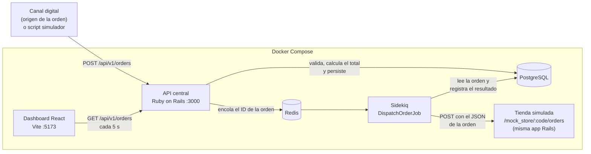
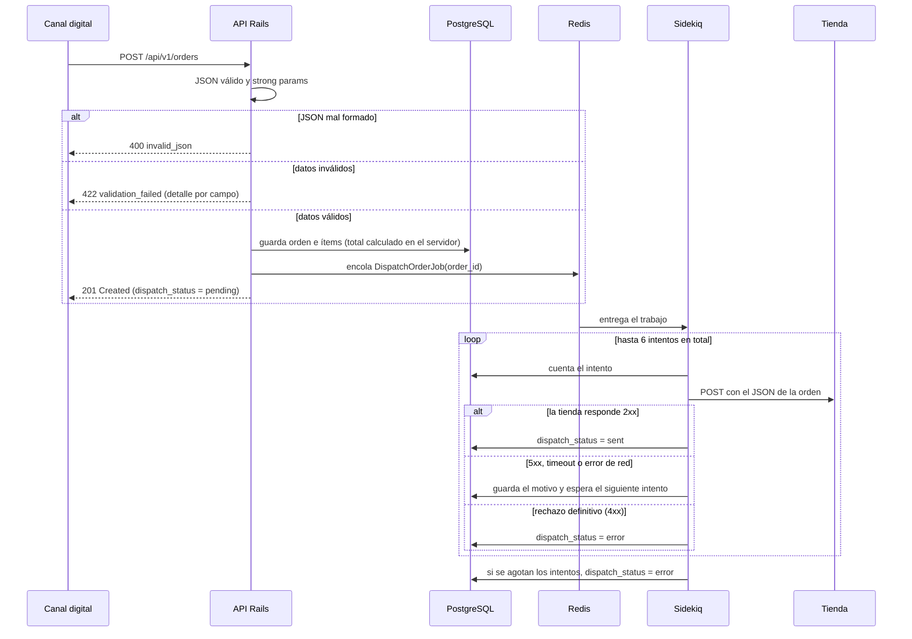
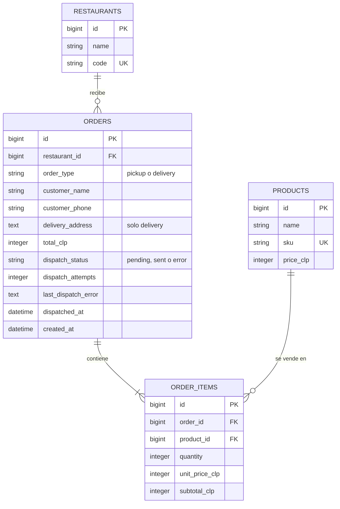

# Niu Orders

API central de órdenes para una franquicia de restaurantes (prueba técnica Ruby on Rails).

Recibe órdenes desde canales digitales, las **valida**, **calcula su total en el servidor**, las **guarda en PostgreSQL**, determina la tienda de destino y las **despacha** a esa tienda en segundo plano con **Sidekiq** (con reintentos y estado de despacho). Un dashboard en React permite revisarlas.

**Resultado:** una orden válida entra por la API, queda registrada, se asocia a una tienda y se despacha a esa tienda. El dashboard la muestra y cambia de **Pendiente** a **Enviado** sin recargar.

## Contenido

1. [Resumen de la solución](#resumen-de-la-solución)
2. [Instalación y ejecución](#instalación-y-ejecución)
3. [Arquitectura](#arquitectura)
4. [Flujo completo de una orden](#flujo-completo-de-una-orden)
5. [Diseño de base de datos](#diseño-de-base-de-datos)
6. [API: referencia y ejemplos](#api-referencia-y-ejemplos)
7. [Tienda simulada](#tienda-simulada)
8. [Script de simulación de órdenes](#script-de-simulación-de-órdenes)
9. [Dashboard](#dashboard)
10. [Tests](#tests)
11. [Decisiones técnicas](#decisiones-técnicas)
12. [Limitaciones y mejoras futuras](#limitaciones-y-mejoras-futuras)
13. [Estructura del repositorio](#estructura-del-repositorio)
14. [Historial de commits](#historial-de-commits)

## Resumen de la solución

| Requisito de la prueba | Dónde está resuelto |
|---|---|
| Diagrama de conexión y diseño de datos | [Arquitectura](#arquitectura) y [Diseño de base de datos](#diseño-de-base-de-datos) |
| Endpoint para crear órdenes con payload JSON | `POST /api/v1/orders` ([ejemplos](#api-referencia-y-ejemplos)) |
| Validaciones de modelo y strong params | `Order`, `OrderItem`, `OrdersController#order_params` |
| Total calculado y persistido por el servidor | `Order#calculate_total` y `OrderItem#calculate_amounts` |
| Persistencia en PostgreSQL | Tablas `restaurants`, `products`, `orders`, `order_items` |
| Despacho a la tienda correspondiente | `DispatchOrderJob` (Sidekiq) + `StoreDispatcher` (HTTP) |
| Errores de validación y fallos de entrega | [Formato de error estándar](#formato-de-error) y [reintentos con estado de despacho](#estados-de-despacho) |
| Script que genera órdenes con el dataset | [`api/scripts/simulate_orders.rb`](#script-de-simulación-de-órdenes) |
| Simulación de la recepción en tienda | [Tienda simulada](#tienda-simulada) (`POST /mock_store/:store_code/orders`) |
| Interfaz para revisar las órdenes | [Dashboard](#dashboard) (React + Vite) |

## Instalación y ejecución

### Requisitos

- **Docker** con Docker Compose v2. No hace falta instalar Ruby, Node ni PostgreSQL: todo corre en contenedores.
- **Windows:** Docker Desktop con WSL2. Conviene clonar el repositorio dentro del sistema de archivos de Linux (por ejemplo `~/code`) y no en `C:\`, porque así Docker es mucho más rápido.
- Puertos libres: `3000` (API), `5173` (dashboard).

### Pasos

```bash
# 1. Clonar el repositorio
git clone <url-del-repositorio> niu-orders
cd niu-orders

# 2. Construir y levantar los 5 servicios (la primera vez tarda unos minutos)
docker compose up --build -d

# 3. Crear la base de datos, aplicar las migraciones y cargar los datos iniciales
docker compose exec api bin/rails db:create db:migrate db:seed
```

El paso 3 carga los 3 restaurantes y los 10 productos de la prueba, con los mismos IDs del dataset (por eso el payload de referencia, `restaurant_id: 2` y `product_id: 1` y `5`, funciona tal cual). Es **idempotente**: se puede repetir sin duplicar datos.

### Comprobar que todo funciona

```bash
docker compose ps                       # api, db, redis, sidekiq y web en "running"
curl -i http://localhost:3000/up        # 200 OK
docker compose exec api ruby scripts/simulate_orders.rb   # envía 20 órdenes de ejemplo
```

Luego abre **http://localhost:5173**: verás las órdenes con su estado de despacho.

### Servicios

| Servicio | Qué es | Puerto |
|---|---|---|
| `api` | API Rails; también aloja la tienda simulada | 3000 |
| `sidekiq` | Procesa en segundo plano el despacho a tiendas | (interno) |
| `db` | PostgreSQL 16 | (interno) |
| `redis` | Cola de Sidekiq (Redis 7, con persistencia en disco) | (interno) |
| `web` | Dashboard React (Vite, Node 22) | 5173 |

### Variables de entorno

Ya traen valores por defecto en `docker-compose.yml`; solo se cambian para probar escenarios.

| Variable | Por defecto | Para qué sirve |
|---|---|---|
| `MOCK_STORE_FAILURE_RATE` | `0` | Probabilidad (0 a 1) de que la tienda simulada falle. Con `1` falla siempre |
| `STORE_BASE_URL` | `http://api:3000/mock_store` | Dónde están las tiendas. Apunta a la tienda simulada; en un sistema real sería la URL de cada sucursal |
| `CORS_ORIGINS` | `http://localhost:5173,http://127.0.0.1:5173` | Orígenes de navegador autorizados a leer la API (separados por coma). En producción no hay valor por defecto |
| `REDIS_URL` | `redis://redis:6379/0` | Conexión de Sidekiq a Redis |
| `DATABASE_HOST`, `DATABASE_USER`, `DATABASE_PASSWORD` | `db`, `postgres`, `postgres` | Conexión a PostgreSQL (solo desarrollo) |
| `VITE_API_URL` | `http://localhost:3000` | Dirección de la API que usa el **navegador** |
| `VITE_USE_POLLING` | `false` | Actívalo si el dashboard no se recarga solo al editar archivos |
| `API_URL` | `http://localhost:3000` | Dirección que usa el script simulador |

Las variables se pasan al levantar los servicios. Ejemplo:

```bash
MOCK_STORE_FAILURE_RATE=1 docker compose up -d
```

### Comandos útiles

```bash
docker compose logs -f sidekiq          # ver los despachos y reintentos en vivo
docker compose logs -f api              # ver las órdenes que recibe la tienda simulada
docker compose down                     # detener todo (conserva los datos)
docker compose down -v                  # detener y BORRAR los datos (base y cola)
docker compose exec api bin/rails db:reset        # recrear la base de desarrollo con los seeds
docker compose exec api bin/rails console         # consola de Rails
```

## Arquitectura



**La API responde apenas la orden queda guardada.** El envío a la tienda ocurre en segundo plano con Sidekiq por dos razones: una tienda lenta o caída no bloquea al canal que envió la orden, y los fallos de entrega se pueden reintentar sin perder nada.

## Flujo completo de una orden



### Paso a paso

1. **Recepción.** `POST /api/v1/orders` recibe el JSON. Un middleware (`JsonBodyGuard`) rechaza con `400` un JSON mal formado antes de que llegue a Rails.
2. **Validación.** El controlador filtra el cuerpo con **strong params**: solo pasan `restaurant_id`, `order_type`, `delivery_address`, `customer` e `items`. Todo lo demás se descarta, en particular cualquier `total_clp`, `unit_price_clp` o `dispatch_status` que informe el cliente. Luego validan los modelos `Order` y `OrderItem` (ver [reglas](#reglas-de-validación)). Si algo falla, responde `422` con el detalle por campo y no se guarda nada.
3. **Cálculo del total.** Antes de validar, cada ítem **copia el precio vigente del producto** (`unit_price_clp`) y calcula su subtotal; la orden suma los subtotales. El total nunca se toma del cliente.
4. **Persistencia.** La orden y sus ítems se guardan en una sola transacción: se guardan todos o ninguno.
5. **Asociación con la tienda.** El `restaurant_id` del payload determina la tienda de destino. Cada orden se envía a la URL de **su** restaurante: `{STORE_BASE_URL}/{código}/orders`, por ejemplo `/mock_store/LCON/orders`.
6. **Encolado.** Con la orden ya guardada, la API encola `DispatchOrderJob(order_id)` y responde `201` con `dispatch_status: "pending"`.
7. **Despacho.** Sidekiq ejecuta el trabajo: cuenta el intento, envía el JSON de la orden a la tienda y clasifica la respuesta. El resultado queda registrado en la propia orden.
8. **Visualización.** El dashboard consulta el listado cada 5 segundos y muestra el estado actualizado.

### Estados de despacho

| Estado | Significado | `dispatch_attempts` | `last_dispatch_error` |
|---|---|---|---|
| `pending` | Orden guardada, aún no confirmada por la tienda (incluye los reintentos en curso) | Sube con cada intento | Motivo del último fallo, si lo hubo |
| `sent` | La tienda confirmó la recepción (2xx) | Intentos que hicieron falta | Se limpia; se guarda `dispatched_at` |
| `error` | Rechazo definitivo o reintentos agotados | Intentos realizados | Motivo del fallo |

### Cómo se clasifica la respuesta de la tienda

| Respuesta | Resultado | Qué pasa |
|---|---|---|
| 2xx | Entregada | La orden queda `sent` |
| 5xx, 408, 429, timeout o error de red | Reintentable | Se guarda el motivo y se reintenta |
| Otro 4xx o 3xx | Rechazo definitivo | La orden queda `error`; reintentar no lo arreglaría |

**Reintentos:** esperas crecientes de **5, 15, 30, 60 y 120 segundos** (6 intentos en total, unos 4 minutos). Si se agotan, la orden queda en `error` con el último motivo. Una orden `sent` nunca se reenvía: si el mismo trabajo se ejecutara dos veces, la segunda no duplica el pedido.

## Diseño de base de datos



| Tabla | Campos clave | Restricciones |
|---|---|---|
| `restaurants` | `name`, `code` | `code` único (PROV, LCON, NUNO) |
| `products` | `name`, `sku`, `price_clp` | `sku` único; `price_clp` entero mayor que 0 |
| `orders` | `restaurant_id`, `order_type`, datos del cliente, `total_clp`, estado de despacho | Claves foráneas; `order_type` y `dispatch_status` limitados a sus valores; índices en `dispatch_status` y `created_at` (para filtrar y ordenar en el dashboard) |
| `order_items` | `order_id`, `product_id`, `quantity`, `unit_price_clp`, `subtotal_clp` | `quantity` y montos mayores que 0; único por (`order_id`, `product_id`) |

Las reglas importantes están protegidas **también en la base de datos** (restricciones `CHECK`, índices únicos y claves foráneas), no solo en los modelos: así un dato inválido no entra aunque dos peticiones simultáneas pasen la validación a la vez.

### Reglas de validación

- La orden debe tener **al menos un ítem**, sin repetir productos (para pedir más unidades se usa `quantity`).
- `quantity`: entero mayor que 0.
- `restaurant_id` y cada `product_id` deben existir.
- `order_type`: `pickup` o `delivery`. Un valor desconocido da `422`, no un error del servidor.
- `delivery_address`: obligatoria si es `delivery`.
- `customer.name` obligatorio. `customer.phone` obligatorio, con prefijo `+` opcional y entre 8 y 15 dígitos; se ignoran espacios y guiones (`+56 9 1234-5678` se guarda como `+56912345678`).

### Dataset (seeds)

| ID | Restaurante | Código |
|---|---|---|
| 1 | Niu Foods Providencia | PROV |
| 2 | Niu Foods Las Condes | LCON |
| 3 | Niu Foods Ñuñoa | NUNO |

| ID | Producto | SKU | Precio CLP |
|---|---|---|---|
| 1 | Niu Roll Salmón | SKU-001 | 8.990 |
| 2 | California Ebi | SKU-002 | 7.490 |
| 3 | Avocado Roll | SKU-003 | 6.990 |
| 4 | Nigiri Salmón x2 | SKU-004 | 3.990 |
| 5 | Gyozas de Pollo x5 | SKU-005 | 4.490 |
| 6 | Edamame | SKU-006 | 3.290 |
| 7 | Bowl Salmón Teriyaki | SKU-007 | 9.990 |
| 8 | Bowl Pollo Teriyaki | SKU-008 | 8.990 |
| 9 | Bebida 350 ml | SKU-009 | 1.990 |
| 10 | Agua Mineral 500 ml | SKU-010 | 1.590 |

## API: referencia y ejemplos

Base: `http://localhost:3000`. Todas las respuestas son JSON.

| Método y ruta | Para qué sirve | Respuestas |
|---|---|---|
| `POST /api/v1/orders` | Crear una orden | 201, 400, 422 |
| `GET /api/v1/orders` | Listado paginado, de la más reciente a la más antigua | 200, 422 |
| `GET /api/v1/orders/:id` | Detalle de una orden | 200, 404 |
| `GET /up` | Health check | 200 |

### Crear una orden

**Payload:**

| Campo | Tipo | Obligatorio | Notas |
|---|---|---|---|
| `restaurant_id` | entero | Sí | Debe existir |
| `order_type` | texto | Sí | `pickup` o `delivery` |
| `customer.name` | texto | Sí | |
| `customer.phone` | texto | Sí | 8 a 15 dígitos, `+` opcional |
| `delivery_address` | texto | Solo en `delivery` | |
| `items[].product_id` | entero | Sí | Debe existir; no se puede repetir |
| `items[].quantity` | entero | Sí | Mayor que 0 |

Cualquier otro campo (`total_clp`, `unit_price_clp`, `dispatch_status`, `id`...) **se ignora**: los define el servidor.

**Ejemplo (el payload de referencia de la prueba):**

```bash
curl -i -X POST http://localhost:3000/api/v1/orders \
  -H "Content-Type: application/json" \
  -d '{
    "restaurant_id": 2,
    "order_type": "delivery",
    "customer": { "name": "Ana Pérez", "phone": "+56912345678" },
    "delivery_address": "Av. Providencia 1234, Santiago",
    "items": [
      { "product_id": 1, "quantity": 2 },
      { "product_id": 5, "quantity": 1 }
    ]
  }'
```

**Respuesta `201 Created`:** el total es 8.990 × 2 + 4.490 × 1 = 22.470, calculado por el servidor.

```json
{
  "id": 31,
  "restaurant": { "id": 2, "code": "LCON", "name": "Niu Foods Las Condes" },
  "order_type": "delivery",
  "customer": { "name": "Ana Pérez", "phone": "+56912345678" },
  "delivery_address": "Av. Providencia 1234, Santiago",
  "total_clp": 22470,
  "dispatch_status": "pending",
  "dispatch_attempts": 0,
  "dispatched_at": null,
  "last_dispatch_error": null,
  "created_at": "2026-10-27T07:41:12Z",
  "items": [
    { "product_id": 1, "name": "Niu Roll Salmón", "sku": "SKU-001", "quantity": 2, "unit_price_clp": 8990, "subtotal_clp": 17980 },
    { "product_id": 5, "name": "Gyozas de Pollo x5", "sku": "SKU-005", "quantity": 1, "unit_price_clp": 4490, "subtotal_clp": 4490 }
  ]
}
```

La respuesta llega antes de despachar, por eso `dispatch_status` es `pending`. Segundos después, la orden pasa a `sent` (se ve en el dashboard o con `GET /api/v1/orders/31`).

### Formato de error

Todos los errores de la API tienen la misma forma:

```json
{
  "error": {
    "code": "validation_failed",
    "message": "Los datos enviados no son válidos",
    "details": { "delivery_address": ["can't be blank"] }
  }
}
```

- `code`: identificador estable, pensado para que lo lea un programa.
- `message`: explicación breve para una persona.
- `details`: solo en validaciones; mensajes por campo. Los ítems se reportan con su campo, por ejemplo `items.quantity` o `items.product`.

| Situación | Status | `code` |
|---|---|---|
| Datos inválidos | 422 | `validation_failed` |
| JSON mal formado | 400 | `invalid_json` |
| Ruta u orden inexistente | 404 | `not_found` |
| Error inesperado | 500 | `internal_error` (sin detalles internos) |

**Ejemplo de validación:** un delivery sin dirección → `422`:

```bash
curl -i -X POST http://localhost:3000/api/v1/orders \
  -H "Content-Type: application/json" \
  -d '{
    "restaurant_id": 2,
    "order_type": "delivery",
    "customer": { "name": "Ana Pérez", "phone": "+56912345678" },
    "items": [ { "product_id": 1, "quantity": 2 } ]
  }'
```

**Ejemplo de ítem inválido:** un producto inexistente devuelve `422` con `items.product` en `details`:

```bash
curl -s -X POST http://localhost:3000/api/v1/orders \
  -H "Content-Type: application/json" \
  -d '{
    "restaurant_id": 2,
    "order_type": "pickup",
    "customer": { "name": "Ana Pérez", "phone": "+56912345678" },
    "items": [ { "product_id": 999, "quantity": 1 } ]
  }'
```

**Ejemplo de JSON mal formado** → `400`:

```bash
curl -i -X POST http://localhost:3000/api/v1/orders \
  -H "Content-Type: application/json" \
  -d '{"restaurant_id": 2,'
```

### Listar órdenes

```bash
curl -s "http://localhost:3000/api/v1/orders?per_page=5&dispatch_status=sent&order_type=delivery"
```

| Parámetro | Por defecto | Notas |
|---|---|---|
| `page` | 1 | Entero mayor que 0. Una página fuera de rango devuelve `data` vacío |
| `per_page` | 20 | Máximo 100; un valor mayor se recorta y `meta` informa el usado |
| `dispatch_status` | | `pending`, `sent` o `error` |
| `restaurant_id` | | ID del restaurante |
| `order_type` | | `pickup` o `delivery` |

Un parámetro inválido (`page=0`, `dispatch_status=foo`) responde `422` con el detalle. La respuesta trae un **resumen** de cada orden, con lo que necesita una fila de tabla:

```json
{
  "data": [
    {
      "id": 31,
      "restaurant": { "id": 2, "code": "LCON", "name": "Niu Foods Las Condes" },
      "order_type": "delivery",
      "total_clp": 22470,
      "dispatch_status": "sent",
      "dispatch_attempts": 1,
      "last_dispatch_error": null,
      "items_count": 2,
      "created_at": "2026-10-27T07:41:12Z"
    }
  ],
  "meta": { "page": 1, "per_page": 5, "total_count": 18, "total_pages": 4 }
}
```

### Detalle de una orden

```bash
curl -s http://localhost:3000/api/v1/orders/31
```

Devuelve la orden completa (la misma forma del `201` de la creación): cliente, dirección, productos con cantidades y precios, y estado de despacho. Una orden inexistente responde `404`.

## Tienda simulada

Simula el sistema de cada restaurante. Vive en la misma app Rails y **solo existe fuera de producción**: es una herramienta de desarrollo y pruebas, no parte de la API real.

```
POST /mock_store/:store_code/orders      (store_code = PROV, LCON o NUNO)
```

Recibe el **mismo JSON** que devuelve la API al crear una orden (es lo que envía `DispatchOrderJob`). Valida que venga completo y que esté dirigido a **esa** tienda.

| Respuesta | Cuándo |
|---|---|
| `200` `{"status":"received",...}` | Orden recibida |
| `404` `store_not_found` | La tienda no existe |
| `422` | Payload incompleto, o dirigido a otra tienda (`store_mismatch`) |
| `503` `store_unavailable` | Fallo simulado |

Cada recepción queda en el log de la API: `[MockStore LCON] Orden #31 recibida: delivery, total 22470 CLP, 2 ítem(s)`.

### Simular fallos

Sirve para ver los reintentos en acción. Hay dos formas:

- **Para todo el sistema:** la variable `MOCK_STORE_FAILURE_RATE` (de 0 a 1) define la probabilidad de un `503`.
- **Para una petición:** el header `X-Mock-Store-Behavior: fail` fuerza un `503`; `ok` fuerza un éxito. El header manda sobre la variable.

**Receta: ver los tres estados en el dashboard**

```bash
# 1. Tienda caída: las órdenes quedan Pendiente con intentos crecientes
MOCK_STORE_FAILURE_RATE=1 docker compose up -d
docker compose exec api ruby scripts/simulate_orders.rb --count 3 --invalid 0
docker compose logs -f sidekiq        # verás los errores y los reintentos (Ctrl+C para salir)

# 2. La tienda se recupera: los reintentos pendientes se entregan solos
docker compose up -d

# 3. Si se deja caída más de ~4 minutos, las órdenes pasan a "Error"
```

Con `MOCK_STORE_FAILURE_RATE=0.5` se ve una mezcla: unas órdenes se entregan al primer intento y otras tras 2 o 3.

## Script de simulación de órdenes

`api/scripts/simulate_orders.rb` genera órdenes con el dataset de productos y las envía a la API, como lo harían los canales digitales. Usa solo la biblioteca estándar de Ruby y **no carga Rails**: se comporta como un cliente externo.

```bash
docker compose exec api ruby scripts/simulate_orders.rb                       # 20 órdenes, 3 inválidas
docker compose exec api ruby scripts/simulate_orders.rb --count 30 --invalid 5
docker compose exec api ruby scripts/simulate_orders.rb --seed 42             # repite la misma secuencia
docker compose exec api ruby scripts/simulate_orders.rb --help
```

| Opción | Por defecto | Qué hace |
|---|---|---|
| `--count N` | 20 | Total de órdenes a enviar |
| `--invalid N` | 3 | Cuántas de ellas son inválidas a propósito |
| `--seed N` | aleatoria | Semilla del azar: la misma semilla repite las mismas órdenes |
| `--delay S` | 0 | Pausa entre órdenes, en segundos |
| `--url URL` | `http://localhost:3000` | URL de la API (también `API_URL`) |

**Qué genera**

- Órdenes con **1 a 4 productos** distintos del dataset y **cantidades de 1 a 5**.
- Las **3 tiendas** y **ambos tipos de pedido** (`pickup` y `delivery`), en rotación: con 6 órdenes o más aparecen las 6 combinaciones. Los `delivery` llevan dirección.
- **Órdenes inválidas a propósito**, tomadas de 8 escenarios: delivery sin dirección, restaurante inexistente, producto inexistente, cantidad cero, orden sin productos, producto repetido, teléfono inválido y tipo de pedido desconocido.

**Qué verifica de cada respuesta**

- **Orden válida:** espera `201`, y que el `total_clp` y la tienda que devolvió la API coincidan con lo que el script calculó por su cuenta con el dataset.
- **Orden inválida:** espera `422` con el error del campo correcto.
- Cualquier otra respuesta se marca como `FALLA` y se detalla al final.

**Salida (ejemplo)**

```
Simulador de órdenes -> http://localhost:3000
  20 órdenes (3 inválidas a propósito) | semilla 48213 (repite con --seed 48213)

[ 1/20] PROV pickup   2 ítem(s) -> 201 orden #31 total $ 22.470  OK
[ 2/20] LCON delivery 3 ítem(s) -> 201 orden #32 total $ 31.960  OK
[ 3/20] INVÁLIDA: cantidad cero -> 422 items.quantity  OK
...
Resumen
  Órdenes enviadas ......... 20
  Aceptadas (201) .......... 17  (monto total $ 389.420)
  Rechazadas (422) ......... 3
  Resultados inesperados ... 0
```

**Código de salida:** `0` si todo salió como se esperaba, `1` si hubo resultados inesperados, `2` si la API no es alcanzable (tras 3 fallos de conexión seguidos se detiene con un mensaje claro) o las opciones son incorrectas.

## Dashboard

Aplicación React (Vite) en `web/`, en **http://localhost:5173**. Consume la API; no tiene lógica de negocio propia.

**Vista principal:** tabla de órdenes, de la más reciente a la más antigua, con paginación.

| Columna | Contenido |
|---|---|
| N.º de orden | `#31` |
| Tienda | Nombre y código del restaurante de destino |
| Monto total | En pesos chilenos (`$22.470`) |
| Tipo | Retiro o Delivery |
| Fecha y hora | Creación, en la hora local del navegador |
| Estado de despacho | Etiqueta de color: **Pendiente**, **Enviado** o **Error**. En un error, al pasar el mouse se ve el motivo; si hubo reintentos, se indica el número de intentos |

**Otras funciones**

- **Filtros** por estado de despacho, tienda y tipo de pedido (cambiar un filtro vuelve a la página 1).
- **Actualización automática** cada 5 segundos, silenciosa (la tabla no parpadea), que se pausa si la pestaña está oculta. Se puede apagar con una casilla, o actualizar a mano.
- **Detalle de cada orden:** al hacer clic en una fila (o con teclado en el número de orden) se abre un panel con el cliente, la dirección de entrega, los productos con cantidad, precio unitario y subtotal, y el historial de despacho. También se mantiene al día mientras está abierto.
- Si la API cae, se muestra un aviso con «Reintentar» y la pantalla conserva lo que ya había.

## Tests

```bash
docker compose exec api bundle exec rspec     # API (Rails, RSpec)
docker compose exec web npm test              # dashboard (Vitest + Testing Library)
```

**API (RSpec):** modelos (validaciones, cálculo del total, precio congelado), seeds, endpoints (creación, listado, detalle, casos borde, errores estándar, CORS), servicios (`OrderCreator`, `OrderSearch`, `StoreDispatcher`), el job de despacho con sus reintentos, la tienda simulada y el script simulador. Hay además un **spec de flujo completo** que recorre API → cola → job → despachador → tienda simulada sin reemplazar ninguna pieza por un doble: tienda disponible, tienda caída con recuperación, reintentos agotados y rechazo definitivo.

**Dashboard (Vitest):** cliente de la API, formatos, hooks de carga y actualización automática, y los componentes.

Los tests de la API no dependen de Redis ni de la red: Sidekiq corre en modo de prueba y las llamadas HTTP se interceptan con WebMock. Tampoco dependen de las variables de tu entorno (por ejemplo, `MOCK_STORE_FAILURE_RATE=1` no los afecta).

## Decisiones técnicas

- **API Rails separada del dashboard.** `api/` solo expone JSON y `web/` lo consume, como pide el enunciado. React porque el front es libre y permite una vista que se actualiza sola; se levanta como un servicio más de Compose, sin instalar Node.
- **Docker Compose para todo.** Un `docker compose up` deja corriendo base de datos, cola, API, worker y dashboard; el entorno es el mismo para quien revise la prueba.
- **Montos como enteros en CLP.** El peso chileno no tiene decimales, así que se evitan `float` y `decimal` y los errores de redondeo.
- **El total lo calcula siempre el servidor.** Se suma `precio × cantidad` desde la base de datos; cualquier total que informe el cliente se ignora. Los strong params descartan además `unit_price_clp` y `dispatch_status`.
- **Precio congelado en cada ítem.** `unit_price_clp` guarda el precio al momento de la compra, para que un cambio posterior en el catálogo no altere órdenes históricas.
- **Reglas de negocio en los modelos, no en el controlador.** El servicio `OrderCreator` solo traduce el payload JSON (cliente anidado, ítems por `product_id`) a una orden; así ninguna orden puede guardarse con un total inventado, venga de donde venga.
- **Integridad también en la base de datos.** Restricciones `CHECK`, índices únicos y claves foráneas respaldan las validaciones del modelo frente a peticiones simultáneas.
- **Cliente dentro de la orden.** La prueba no pide gestionar clientes, así que nombre y teléfono viven en `orders` en vez de una tabla aparte.
- **Un producto por orden.** Repetirlo se rechaza con `422`; para pedir más unidades se usa `quantity`.
- **Enums como texto.** `order_type` y `dispatch_status` se guardan como texto legible, lo que facilita consultar la base y leer el JSON.
- **Despacho asíncrono con Sidekiq.** La API no depende de que la tienda esté disponible. El job recibe el `order_id` (no el objeto) y lee la orden fresca en cada intento.
- **Reintentos solo para lo reintentable.** 5xx, 408, 429, timeouts y errores de red se reintentan con espera creciente; un 4xx es un rechazo definitivo y no se reintenta. Los errores de programación no se esconden: fallan de forma visible.
- **Estado de despacho en la propia orden.** `dispatch_status`, `dispatch_attempts`, `last_dispatch_error` y `dispatched_at` hacen que el dashboard no necesite consultar Sidekiq. El intento se cuenta antes de enviar, con un incremento atómico, y los cambios de estado no revalidan la orden para que registrar un resultado nunca dependa de datos ajenos.
- **Despacho sin duplicados.** Una orden `sent` no se reenvía, y cada envío lleva el header `X-Idempotency-Key: order-<id>`, igual en cada reintento, para que una tienda real pueda ignorar duplicados.
- **Si Redis cae, la orden no se pierde.** Ya está guardada como `pending`: se registra el error en el log y la API igual responde `201`, en vez de devolver un `500` por un pedido que sí quedó registrado.
- **Un solo formato de error** (`code`, `message`, `details`) para validación, JSON mal formado, rutas inexistentes y errores inesperados. El `500` no filtra detalles internos.
- **Una URL por tienda en la tienda simulada.** Hace visible el enrutamiento a la tienda correcta y permite verificar que una orden no llegue a otra sucursal.
- **CORS de solo lectura.** Se autoriza únicamente `GET`, `HEAD` y `OPTIONS` bajo `/api/*` para el origen del dashboard. Los canales que crean órdenes son clientes de servidor, a los que CORS no afecta. En producción no hay origen por defecto.
- **Paginación propia** (`limit` y `offset`), sin gemas: alcanza para este volumen. El listado precarga restaurante e ítems, sin consultas extra por fila, y un test lo comprueba.
- **Actualización por polling** (cada 5 s) en el dashboard: simple, sin infraestructura adicional. Es silenciosa, no se apila, se pausa con la pestaña oculta y una respuesta vieja nunca pisa a una nueva.
- **Un único cliente de la API en el front.** El dashboard habla con la API solo a través de `src/api/client.js`, con errores tipados (`ApiError`) que distinguen una API caída de una respuesta de error, y se prueba sin red.
- **Tests aislados del entorno.** Sidekiq en modo de prueba, WebMock para HTTP y variables de entorno fijadas por test.
- **Comentarios en español, identificadores en inglés.** Cada clase explica qué responsabilidad tiene y por qué existe; los comentarios de método solo aparecen donde la decisión no es obvia.

## Limitaciones y mejoras futuras

Lo que está fuera del alcance de la prueba, o se simplificó a propósito:

- **Sin autenticación.** La API no identifica a los canales que crean órdenes. En producción haría falta una API key o credenciales por canal.
- **Sin idempotencia en la creación.** Enviar dos veces el mismo `POST` crea dos órdenes. Una mejora natural es aceptar un header `Idempotency-Key`.
- **Entrega "al menos una vez".** Si la tienda recibe la orden pero la respuesta se pierde, habrá un reintento. El header `X-Idempotency-Key` permite que una tienda real lo detecte.
- **Órdenes sin trabajo encolado.** Si Redis falla justo al crear una orden, esta queda `pending` pero nadie la despacha. Una tarea periódica que vuelva a encolar las pendientes antiguas lo cubriría.
- **Reenvío manual de órdenes en `error`.** No hay un endpoint ni un botón para reintentar una orden que agotó sus intentos, ni una interfaz para la cola de Sidekiq (por ejemplo, `Sidekiq::Web`).
- **Tiendas.** La tienda simulada consulta la tabla `restaurants` de la API, y el filtro de tiendas del dashboard está declarado en el front porque la API no expone un listado. En un sistema real convendría un endpoint `GET /api/v1/restaurants` y una URL de destino configurable por sucursal.
- **Idioma de los errores de validación.** Los mensajes de `error.details` provienen de Rails y están en inglés; `code` es lo que debe leer un programa, y `message` está en español.
- **Orientado a desarrollo.** Imagen `Dockerfile.dev`, credenciales de base de datos fijas en `docker-compose.yml` y servidor de desarrollo de Vite. Un despliegue real requiere imágenes de producción y secretos propios.

## Estructura del repositorio

```
niu-orders/
├── docker-compose.yml          # db, redis, api, sidekiq y web
├── README.md
├── api/                        # API Ruby on Rails
│   ├── app/
│   │   ├── controllers/        # Api::V1::OrdersController, MockStore::OrdersController, errores
│   │   ├── jobs/               # DispatchOrderJob (Sidekiq)
│   │   ├── models/             # Restaurant, Product, Order, OrderItem
│   │   ├── serializers/        # OrderSerializer, OrderSummarySerializer
│   │   └── services/           # OrderCreator, OrderSearch, StoreDispatcher
│   ├── config/                 # rutas, CORS, Sidekiq, JsonBodyGuard
│   ├── db/                     # migraciones, schema.rb y seeds.rb
│   ├── scripts/                # simulate_orders.rb
│   └── spec/                   # tests (RSpec)
└── web/                        # Dashboard React (Vite)
    └── src/
        ├── api/                # cliente de la API
        ├── components/         # tabla, filtros, paginación, detalle...
        ├── hooks/              # carga y actualización automática
        └── lib/                # formatos y filtros
```

## Historial de commits

El proyecto se construyó commit a commit, cada uno pequeño y revisable por sí solo, con sus tests. Para recorrerlo en orden:

```bash
git log --oneline --reverse
```

| Etapa | Commits |
|---|---|
| **Base** | Proyecto Rails API con PostgreSQL · entorno Docker Compose · RSpec, FactoryBot, Faker y shoulda-matchers · diagramas y diseño de datos |
| **Modelos** | `Restaurant` y `Product` · `Order` y `OrderItem` con validaciones · seeds con el dataset |
| **API de órdenes** | `POST /api/v1/orders` con strong params · servicio `OrderCreator` · formato de error estándar · casos borde |
| **Despacho a tienda** | Tienda simulada · `StoreDispatcher` (cliente HTTP) · `DispatchOrderJob` con Sidekiq y reintentos · estado e intentos de despacho en la orden · tests del flujo completo |
| **Simulación** | Script simulador de órdenes |
| **Dashboard** | Endpoints `GET` de listado y detalle · CORS · app React con cliente de la API · tabla con paginación · filtros y actualización automática · panel de detalle |
| **Cierre** | README completo |
