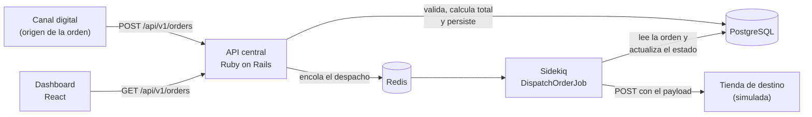
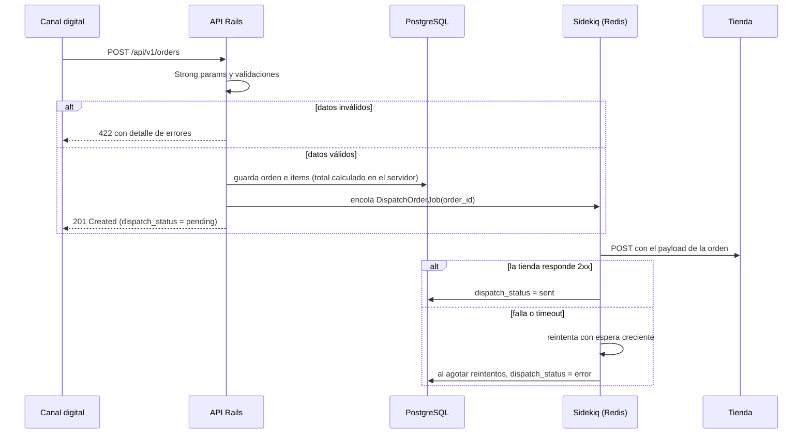
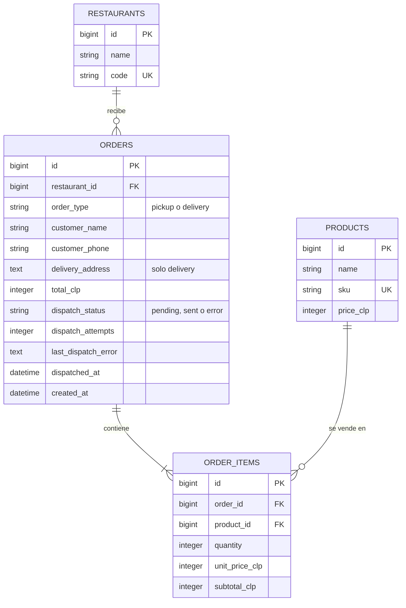

# Niu Orders

API central de órdenes para una franquicia de restaurantes (prueba técnica Ruby on Rails).

Recibe órdenes desde canales digitales, las valida, calcula su total, las guarda en PostgreSQL y las despacha al restaurante que debe prepararlas. Un dashboard permite revisarlas.

## Estructura del repositorio

- `api/`: API en Ruby on Rails (PostgreSQL, Sidekiq).
- `web/`: dashboard de órdenes (React). Se agrega más adelante.
- `docker-compose.yml`: entorno de desarrollo (API + PostgreSQL; Redis y Sidekiq se suman más adelante).

## Entorno de desarrollo (estado actual)

Requisitos: Docker y Docker Compose.

```bash
docker compose up --build -d                 # levanta API y PostgreSQL
docker compose exec api bin/rails db:create  # crea las bases de datos
curl -i http://localhost:3000/up             # health check: debe responder 200
docker compose exec api bundle exec rspec    # ejecuta los tests
```

## Arquitectura

### Vista general



La API responde apenas la orden queda guardada. El envío a la tienda ocurre en segundo plano con Sidekiq, por dos razones: una tienda lenta o caída no bloquea al canal que envió la orden, y los fallos de entrega se pueden reintentar sin perder la orden.

### Flujo de una orden



### Estados de despacho

| Estado | Significado |
|---|---|
| `pending` | Orden guardada; aún no confirmada por la tienda (incluye los reintentos en curso). |
| `sent` | La tienda confirmó la recepción con una respuesta exitosa. |
| `error` | Se agotaron los reintentos sin que la tienda confirmara. |

## Diseño de base de datos



### Tablas

| Tabla | Campos clave | Restricciones |
|---|---|---|
| `restaurants` | `name`, `code` | `code` único (PROV, LCON, NUNO) |
| `products` | `name`, `sku`, `price_clp` | `sku` único; `price_clp` entero |
| `orders` | `restaurant_id`, `order_type`, datos del cliente, `total_clp`, estado de despacho | `delivery_address` obligatoria si es delivery; índices en `restaurant_id`, `dispatch_status` y `created_at` |
| `order_items` | `order_id`, `product_id`, `quantity`, `unit_price_clp`, `subtotal_clp` | `quantity` mayor que 0; único por (`order_id`, `product_id`) |

## Decisiones técnicas

- **Montos como enteros en CLP.** El peso chileno no tiene decimales, así que se evitan `float` y `decimal`, y los errores de redondeo.
- **El total lo calcula el servidor.** Se ignora cualquier total que informe el cliente: se suma `precio del producto × cantidad` desde la base de datos.
- **Precio congelado en cada ítem.** `unit_price_clp` guarda el precio al momento de la compra, para que un cambio posterior en `products` no altere órdenes históricas.
- **Cliente dentro de la orden.** La prueba no pide gestionar clientes, así que nombre y teléfono viven en `orders` en vez de una tabla aparte.
- **Un producto por orden.** Repetir el mismo `product_id` en una orden se rechaza con 422; para pedir más unidades se usa `quantity`.
- **Enums como texto.** `order_type` y `dispatch_status` se guardan como texto legible, lo que facilita consultar la base y leer el JSON.
- **Despacho asíncrono.** El envío a tienda corre en Sidekiq con reintentos; la API no depende de que la tienda esté disponible.
- **API y dashboard separados.** `api/` solo expone JSON y `web/` lo consume, como pide el enunciado.